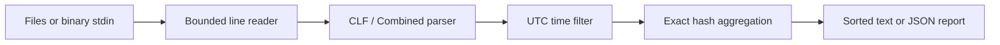

# Architecture

`main.c` owns argument validation, file lifecycle, exit codes, and error reporting. `parser.c` owns bounded input, timestamps, and record validation. `stats.c` owns allocated paths, counters, and filtering. `report.c` sorts pointers to routes rather than changing hash-table storage. `include/logscan.h` defines the internal interface; this is not a separately versioned public library.

The parser requires a NUL-terminated buffer of exactly the supplied length. Only successfully parsed records may be passed to aggregation. The CLI enforces these internal preconditions. Input records are transient stack values; retained path copies belong to `ls_stats` and are released by `ls_free`, including after failure.

## Bounds and complexity

The reader retains at most 8193 bytes plus a terminator, regardless of input line length. A request target is limited to 2048 bytes. Aggregation allocates a fixed route array and a power-of-two open-address table with at least twice the configured capacity. Paths are allocated only for distinct selected targets. For capacity K and maximum path length L, storage is O(KL), independent of the number of lines. Reporting adds O(K) pointers and sorts in O(K log K).

FNV-1a gives expected constant-time lookup but is not collision-resistant. Deliberately colliding inputs can make probing expensive (up to O(K) per request); this tool is intended for offline analysis, not as an exposed network service. It makes no adversarial throughput guarantee.

## Deliberate choices

- Exact top paths rather than approximate heavy hitters: auditability matters more than accepting unlimited cardinality. Capacity exhaustion returns exit 3 with no report.
- UTC integer arithmetic rather than locale/timezone APIs: deterministic results across machines, explicit leap-year rules, no DST ambiguity in numeric log offsets.
- Whole-scan success before rendering: missing later files or overflowing totals never produce a misleading successful partial report.
- Query removal before aggregation: avoids token leakage in common URL patterns while preserving endpoint-level diagnostics. No promise of full anonymization.
- Minimal dependencies: C is visible in buffer management, ownership, hashing, overflow handling, and portable CLI contracts.
